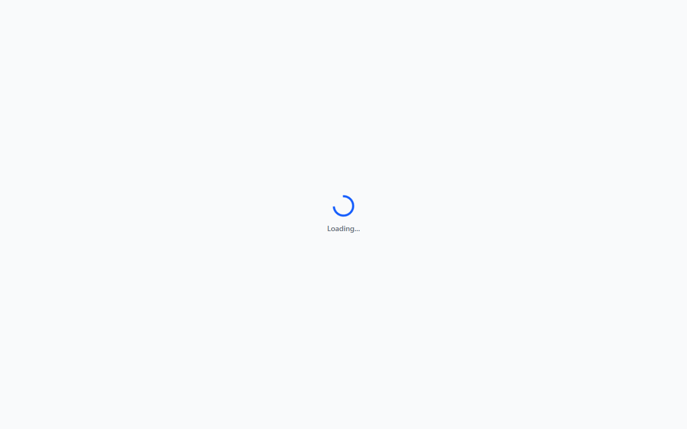
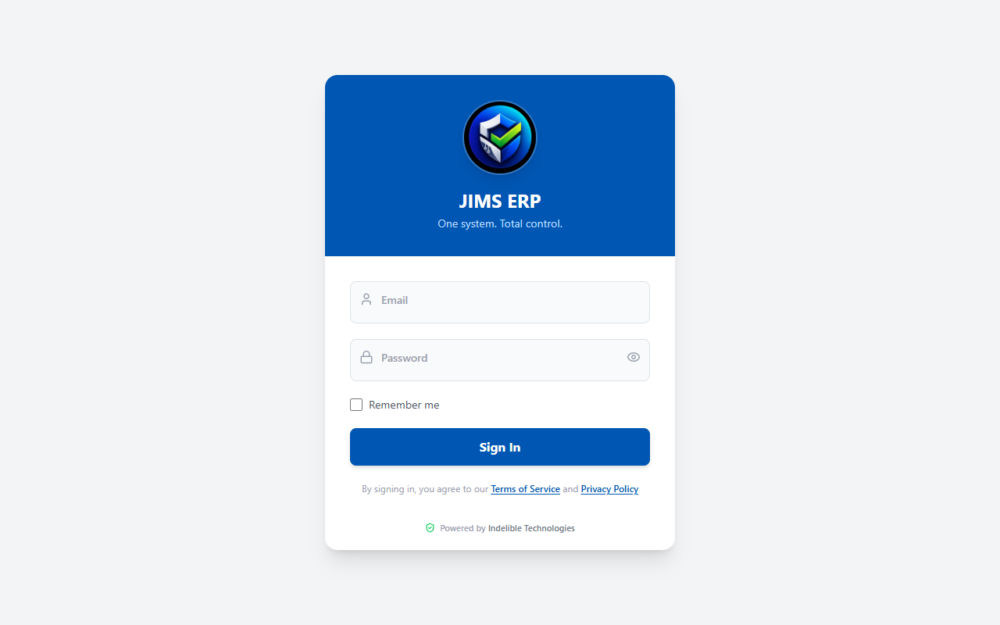

# User Manual — MsikaFlo Business Management System

Welcome to the **MsikaFlo** official user guide. MsikaFlo is a full-featured cloud-connected business management platform covering Point of Sale (POS), inventory management, stationery costing, staff management, financial tracking, online orders, branch management, and security controls.

Built and maintained by **Indelible Technologies**.

> **Developer:** Indelible Technologies — [indelibletechnologiesmw@gmail.com](mailto:indelibletechnologiesmw@gmail.com)  
> **Jurisdiction:** Republic of Malawi  
> **Last updated:** 13 October 2026

---

## Table of Contents
1. [Logging In & Security](#1-logging-in--security)
2. [Dashboard Overview](#2-dashboard-overview)
3. [Point of Sale (POS)](#3-point-of-sale-pos)
4. [Stationery & Print Shop Services](#4-stationery--print-shop-services)
5. [Inventory & Stock Management](#5-inventory--stock-management)
6. [Expenses & Credit Management](#6-expenses--credit-management)
7. [Staff & HR Management](#7-staff--hr-management)
8. [Branches & Multi-Location Management](#8-branches--multi-location-management)
9. [Online Storefront & Orders](#9-online-storefront--orders)
10. [Settings, Security & User Management](#10-settings-security--user-management)
11. [Offline Mode & Auto-Sync](#11-offline-mode--auto-sync)
12. [PWA Installation](#12-pwa-installation)

---

## 1. Logging In & Security

### The Login Screen
The MsikaFlo login screen features a premium dark cosmic design that extends edge-to-edge on Android devices, providing a native app experience.

### Logging In
1. Open the MsikaFlo application on your device (browser or installed PWA).
2. Enter your registered **Email Address** and **Password**.
3. **Remember Me Option:**
   - **Checked:** Your email address is securely remembered in local browser storage for quick login next time. Firebase session is set to `browserLocalPersistence` so you stay signed in across browser restarts.
   - **Unchecked:** No credentials are preserved in local storage. Firebase session is set to `browserSessionPersistence`. Input fields are cleared on logout for maximum privacy on shared devices.
4. Click **Sign In**. Cashiers are automatically directed to the **POS**, while Managers and Admins land on the **Dashboard**.

### Forgot Password
If you forget your password:
1. Enter your **email address** in the email field.
2. Tap **Forgot password?**.
3. A password reset link will be sent to your email by Firebase.
4. Follow the link in your email to securely set a new password.
5. Return to MsikaFlo and sign in with your new credentials.

> **Note:** Admins can also directly reset any staff member's password from **Settings → User Management**.

---

## 2. Dashboard Overview

The **Dashboard** provides real-time business metrics:
- **Today's Revenue & Sales:** Track total sales processed today.
- **Expenses & Net Profit:** Live calculation of daily expenses versus income.
- **Pending Syncs Counter:** Displays any offline transactions queued for background sync.
- **Low Stock Alerts:** Highlights inventory items that have fallen below their reorder thresholds.
- **Quick Action Bar:** Fast shortcuts for New Sale, Add Product, Print Service, and Tech Service.
- **Sales Trends:** Visual charts showing sales performance over selected time periods.
- **Remittance Notifications:** Cashiers receive in-app congratulatory notifications for outstanding sales milestones.

---

## 3. Point of Sale (POS)

### Processing a Sale
1. **Select Items:** Tap any product card or use the search bar to add items to the active cart.
2. **AI Product Finder:** Use the AI-powered camera scanner to identify products by image and auto-add them to the cart.
3. **Adjust Quantities:** Use `+` or `-` buttons next to items in the cart panel.
4. **Apply Discounts:** Enter an item-specific discount or apply an overall cart discount percentage/amount.
5. **Payment Options:** Select the customer's payment method:
   - **Cash**
   - **Mobile Money:** Airtel Money / Mpamba (account details displayed on screen).
   - **Bank Transfer:** NBS Bank / National Bank of Malawi (NBM).
   - **Credit / Pay Later:** Logs the transaction as an outstanding credit balance assigned to the customer.
6. **Complete & Print:** Tap **Complete Sale**. A printable receipt is generated automatically.

### Held Carts
- If a customer needs to pause their order, tap **Hold Cart**.
- Held carts are synchronized to the cloud and can be recalled at any POS counter or device.

### Barcode Scanning
- Use the integrated barcode scanner to look up products instantly by scanning their barcode or QR code.

---

## 4. Stationery & Print Shop Services

The Stationery module handles custom pricing for services like printing, photocopying, scanning, binding, and laminating:
- **Unit Costing:** Includes itemized calculations for labor, electricity, and overhead costs.
- **Material Tracking:** Automatically deducts raw paper or laminate stock from inventory when a stationery service is completed.
- **Standardized Pricing:** Ensures consistent pricing across all cashiers and branches.

---

## 5. Inventory & Stock Management

- **Product Catalog:** View all physical goods, SKUs, cost prices, selling prices, and current stock levels.
- **Stock Decrements:** Stock levels are automatically updated when sales are completed. Cashiers can only decrement stock during valid sales.
- **Reorder Warnings:** Products marked below reorder level appear with visual warnings to prompt restocking.
- **Service Items:** Non-physical services can be flagged as `isService` to prevent inventory deduction.
- **Product Images:** Upload product images to the catalog for visual identification at the POS.

---

## 6. Expenses & Credit Management

### Logging Expenses
1. Navigate to **Expenses**.
2. Tap **Add Expense**, enter the Category (e.g. Utilities, Fuel, Transport, Rent), Description, Amount, and Payer.
3. Saved expenses immediately update the net profit calculations on the Dashboard.

### Credit Management & Repayments
- View all outstanding customer credit balances under **Credits**.
- When a customer makes a partial or full payment, tap **Record Repayment**, enter the amount paid, and the system automatically updates their balance and status (`PENDING`, `OVERDUE`, or `FULLY_PAID`).

---

## 7. Staff & HR Management

Accessible to Admins and Managers:
- **Employee Directory:** Track employee contact details, roles, and base salaries.
- **Employee Profiles:** Full profile pages with personal details, ID documents, next-of-kin contacts, and photo.
- **Attendance Status:** Mark employees as `PRESENT`, `ABSENT`, or `ON LEAVE`.
- **Salary Advance Tracking:** Log salary advances given to staff members and clear them when settled during payroll.
- **Payslips:** Generate and share monthly payslips directly from the system.
- **Employee History:** Full transaction and activity history per employee.

---

## 8. Branches & Multi-Location Management

Accessible to **Admins**:
- **Branch Registry:** Add, view, and manage all business branches and locations.
- **Branch Assignment:** Assign employees and cashier accounts to specific branches.
- **Per-Branch Reporting:** View sales and financial data filtered by branch.

---

## 9. Online Storefront & Orders

### Public Storefront
- Accessible at `/store` or `/shop` — no login required.
- Customers can browse the product catalog and place orders.
- Designed for WhatsApp Commerce integration.

### Online Orders Management
- Admins and Managers can view and process all incoming online orders from the **Online Orders** module.
- Orders can be marked as processed, rejected, or fulfilled.

---

## 10. Settings, Security & User Management

Accessible to **Admins**:
- **Company Branding:** Update business name, address, phone, email, TPIN tax number, and payment account numbers (Airtel, Mpamba, NBS, NBM).
- **Security Controls:**
  - **Automatic System Lock:** Enable business-hours system lockouts.
  - **Idle System Lock:** Automatically lock the system after a specified period of inactivity (e.g., 10 minutes).
- **User Management:** Create new user accounts (Cashier, Manager, Admin), update roles, toggle active status, or issue Firebase password reset emails.
- **Password Change Requests:** Staff can submit password change requests. Admins approve or reject these from the Settings panel.
- **Audit Logs:** Full system audit trail tracking all critical actions, logins, deletions, and administrative changes with exact timestamps.
- **Push Notifications (FCM):** Firebase Cloud Messaging configured for real-time in-app notifications (sales milestones, remittances, alerts).

---

## 11. Offline Mode & Auto-Sync

- **Uninterrupted Operations:** If the internet connection drops, the POS remains 100% operational. Sales are safely stored locally in browser storage.
- **Offline Credential Caching:** Users can log in with their credentials even when the device is completely offline. Passwords are stored as secure SHA-256 hashes — never in plain text.
- **Auto-Sync:** As soon as connectivity is restored, all queued transactions automatically upload to the cloud database in the background.
- **PWA Service Worker:** All static assets, JavaScript bundles, and the background image are pre-cached by the Workbox service worker for instant loading.
- **Clean Logout:** Logging out automatically cleans up all active database listeners, preventing network errors or security leaks on shared computers.

---

## 12. PWA Installation

MsikaFlo can be installed as a native-like app on your device:

### Android (Chrome / Edge)
1. Open MsikaFlo in Chrome.
2. Tap the **three-dot menu (⋮)** → **Add to Home screen**.
3. Confirm the installation prompt.
4. MsikaFlo appears as a full-screen app on your home screen with a transparent status bar.

### iOS (Safari)
1. Open MsikaFlo in Safari.
2. Tap the **Share button (□↑)** → **Add to Home Screen**.
3. Confirm and tap **Add**.
4. MsikaFlo opens in full-screen mode with the cosmic login experience.

---

## Support & Contact

For technical issues, training, or account support, contact:

**Indelible Technologies**
📧 [indelibletechnologiesmw@gmail.com](mailto:indelibletechnologiesmw@gmail.com)
